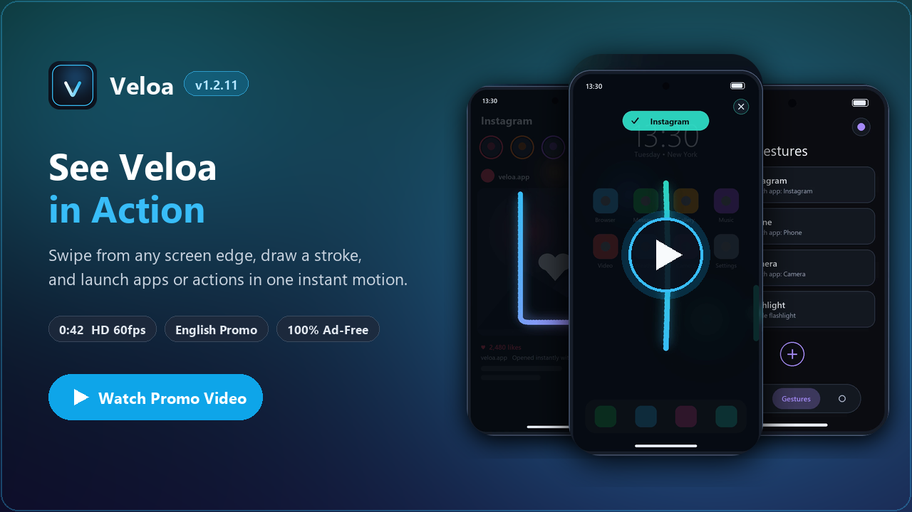
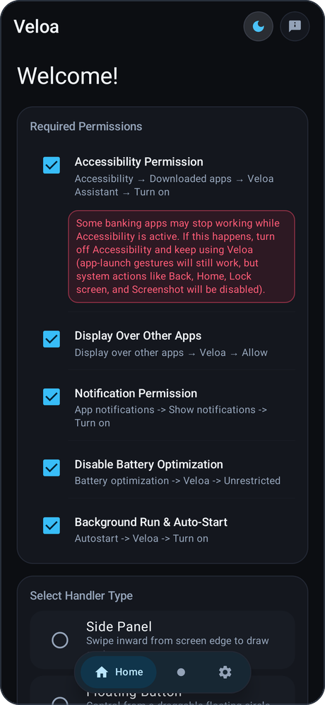
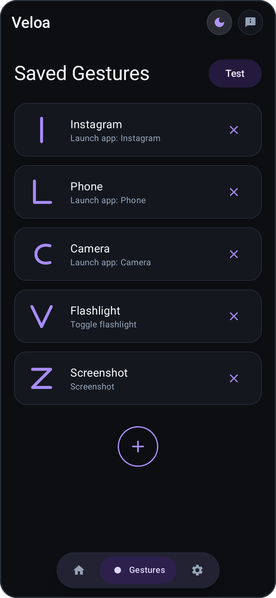
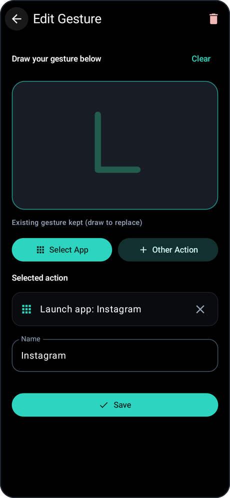
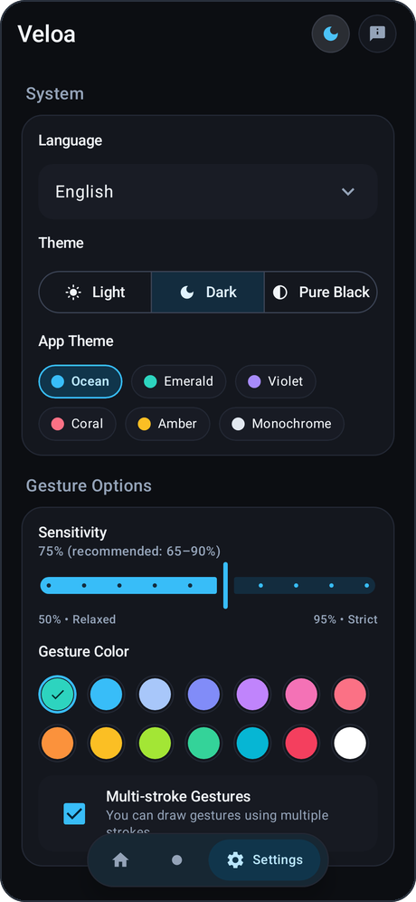

<div align="center">


# Veloa

**Minimalist, fast, and ad-free gesture & side-panel launcher for Android — built 100% with Kotlin & Jetpack Compose (Material 3).**

*Android üçün 100% Kotlin və Jetpack Compose (Material 3) ilə hazırlanmış minimalist, sürətli və reklamsız jest / yan panel köməkçisi.*

[](https://github.com/chatgpt20272027-sys/veloa/releases/tag/v1.2.11)
[](https://kotlinlang.org)
[](https://developer.android.com/compose)
[-3ddc84?style=for-the-badge&logo=android&logoColor=black)](https://developer.android.com)
[](LICENSE)

<br />

**[Download APK (v1.2.11)](https://github.com/chatgpt20272027-sys/veloa/releases/download/v1.2.11/Veloa.apk)** &nbsp;·&nbsp;
**[Watch Promo Video (EN)](https://github.com/chatgpt20272027-sys/veloa/releases/download/v1.2.11/Veloa_Promo_EN.mp4)** &nbsp;·&nbsp;
**[All Releases](https://github.com/chatgpt20272027-sys/veloa/releases)**

</div>

---

## Promo Video

<div align="center">

<a href="https://github.com/chatgpt20272027-sys/veloa/releases/download/v1.2.11/Veloa_Promo_EN.mp4">
  
</a>

<sub>Click the banner above to watch or download the official English promo video (<code>Veloa_Promo_EN.mp4</code> · 0:42 · 1080×1920 · 60fps).</sub>

</div>

---

## Screenshots

<div align="center">

<table>
  <tr>
    <td align="center" width="25%">
      <br />
      <sub><b>Home &amp; Controls</b><br />Permissions, Side Panel &amp; Floating modes</sub>
    </td>
    <td align="center" width="25%">
      <br />
      <sub><b>Saved Gestures</b><br />Custom strokes &amp; built-in Test mode</sub>
    </td>
    <td align="center" width="25%">
      <br />
      <sub><b>Gesture Editor</b><br />Single or multi-stroke assignment</sub>
    </td>
    <td align="center" width="25%">
      <br />
      <sub><b>Themes &amp; Settings</b><br />3 modes × 6 palettes &amp; fine-tuning</sub>
    </td>
  </tr>
</table>

</div>

---

## Features

- **Side Panel & Floating Button Modes**  
  Swipe inward from the left, right, or both screen edges (*Direct draw* in one motion, or *Open first, then draw*), control from a draggable Floating Button with 7 custom triggers (tap, double tap, long press, 4-way swipes), or run both together.
- **Orientation-Faithful Gesture Engine**  
  Pure-Kotlin isotropic recognition engine ([`GestureRecognizer.kt`](app/src/main/kotlin/az/gesture/app/data/GestureRecognizer.kt)) keeps strokes like `|`, `L`, `C`, `V`, `Z`, and multi-stroke shapes equally accurate in both portrait and landscape orientations.
- **1-to-1 Sensitivity Control**  
  Tune matching strictness cleanly between `50%` and `95%`, optionally prioritize stroke direction, and verify shortcuts anytime in the built-in **Test** dialog.
- **Resilient Background Watchdog & Banking-Safe Mode**  
  `VeloaKeepAliveService`, `VeloaWatchdogJobService`, and `KeepAliveRestartReceiver` automatically recover from aggressive OEM RAM cleaners. If a banking app restricts Accessibility Services, disable Accessibility and keep launching apps seamlessly over any screen via **Display Over Other Apps**.
- **Themes, Palettes & Keyboard Awareness**  
  3 theme modes (**Light**, **Dark**, **Pure Black AMOLED**) × 6 color palettes (**Ocean**, **Emerald**, **Violet**, **Coral**, **Amber**, **Monochrome**), auto-hide on keyboard or full-screen landscape, and subtle haptic feedback.
- **100% Minimalist & Offline**  
  Zero ads, zero analytics, zero internet telemetry.

---

## Permissions & Privacy

| Permission | Purpose | Notes |
| :--- | :--- | :--- |
| **Display Over Other Apps** | Renders the edge handle, floating button, and gesture canvas over any screen | Required for both Side Panel and Floating Button |
| **Accessibility Service** *(Optional)* | Executes global system actions (`Back`, `Home`, `Recents`, `Lock screen`, `Screenshot`, `Quick settings`, `Split screen`) | Can be toggled off anytime while keeping app-launch gestures working |
| **Notifications** | Maintains foreground service stability badge on Android 13+ | No promotional or remote notifications |
| **Unrestricted Battery / Auto-Start** | Prevents Xiaomi/Samsung/OEM cleaners from killing background triggers | Guided step-by-step per device manufacturer on the Home tab |

---

## Supported Languages (11)

Full localized UI sorted alphabetically inside **Settings → Language**:

> Azerbaijani (`az`) · English (`en`) · French (`fr`) · German (`de`) · Italian (`it`) · Polish (`pl`) · Portuguese (`pt`) · Russian (`ru`) · Spanish (`es`) · Turkish (`tr`) · Ukrainian (`uk`)

---

## Installation & Build from Source

### Install Pre-built APK

1. Download **`Veloa.apk`** from the [v1.2.11 Release](https://github.com/chatgpt20272027-sys/veloa/releases/tag/v1.2.11).
2. Install the APK on Android 8.0+ (API 26+).
3. On Android 13+, if Accessibility shows *"Restricted setting"*, open **App info → ⋮ (top-right) → Allow restricted settings**.

### Build Locally

Requirements: **JDK 17** and **Android SDK** (`compileSdk 36`, `minSdk 26`).

```bash
# Build Debug APK
./gradlew assembleDebug

# Run Unit Tests (including GestureRecognizerTest)
./gradlew testDebugUnitTest
```

To sign a release build (`./gradlew assembleRelease`), create `keystore.properties` in the project root (git-ignored):

```properties
storeFile=../release.jks
storePassword=YOUR_STORE_PASSWORD
keyAlias=YOUR_ALIAS
keyPassword=YOUR_KEY_PASSWORD
```

---

<details>
<summary><b>Azərbaycan dilində qısa məlumat</b></summary>

**Veloa** — ekranın kənarından sürüşdürərək və ya üzən dairəvi düymədən istifadə edərək ekranda istədiyiniz işarəni çəkməklə tətbiqləri və sistem əməliyyatlarını dərhal işə salan reklamsız, oflayn Android köməkçisidir.

- **Yükləmə (APK)**: [Veloa.apk (v1.2.11)](https://github.com/chatgpt20272027-sys/veloa/releases/download/v1.2.11/Veloa.apk)
- **Tanıtım Videosu (EN)**: [Veloa_Promo_EN.mp4](https://github.com/chatgpt20272027-sys/veloa/releases/download/v1.2.11/Veloa_Promo_EN.mp4)
- **Əsas imkanlar**: Yan Panel (*Birbaşa çək* / *Əvvəl aç, sonra çək*) və Üzən Düymə rejimi, `50%–95%` 1-ə-1 həssaslıq, bank tətbiqləri üçün Əlçatanlıqsız tətbiq açma dəstəyi, 3 tema × 6 rəng palitrası və 11 dil dəstəyi.

</details>
